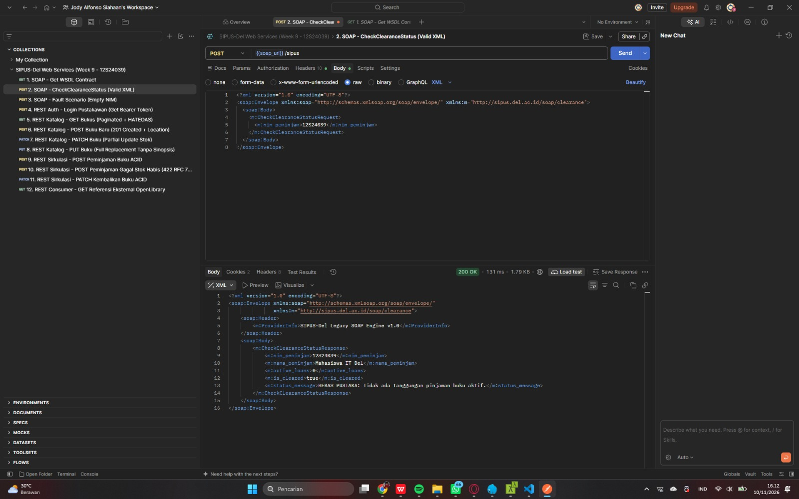
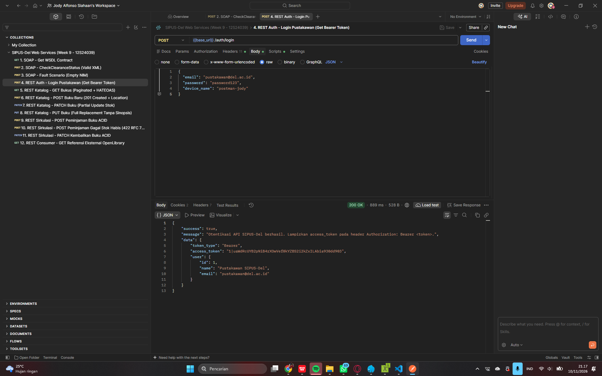

# SIPUS-Del Tahap 3: Arsitektur Web Services (SOAP Legacy & RESTful Web API v1)

## 1. Identitas Mahasiswa
- **Nama Lengkap:** Jody Alfonso Siahaan
- **NIM:** 12S24039
- **Program Studi:** S1 Sistem Informasi - Fakultas Informatika dan Teknik Elektro, Institut Teknologi Del
- **Mata Kuliah:** Pemrograman dan Pengujian Aplikasi Web (1253101) - Minggu 9
- **Branch:** `week9-rest-api`

---

## 2. Analisis Kebutuhan & Kelayakan (Feasibility) Web Services pada SIPUS-Del

### A. Matriks Peran Service Provider vs Service Consumer
| Modul / Fungsionalitas | Peran SIPUS-Del | Protokol & Format Payload | Sistem Mitra / Eksternal | Analisis Kelayakan & Rasionalitas Teknis |
| :--- | :--- | :--- | :--- | :--- |
| **Verifikasi Bebas Pustaka Yudisium** | **Service Provider** | SOAP 1.1 (`text/xml` + WSDL) | Sistem Administrasi Yudisium Kampus (Legacy) | Sistem yudisium lama membutuhkan kontrak WSDL kaku dan amplop `<soap:Envelope>` untuk mengecek apakah mahasiswa masih memiliki pinjaman aktif (`active_loans == 0`). |
| **Layanan Katalog & Sirkulasi Mobile / Kiosk Mandiri** | **Service Provider** | RESTful Web API v1 (`application/json`) | Aplikasi Mobile Mahasiswa & Kiosk Mandiri Perpustakaan | Pertukaran data JSON jauh lebih hemat bandwidth (5-8x lebih ringkas dibanding XML), mendukung arsitektur *stateless* (`Bearer Token`), serta memandu UI secara dinamis melalui HATEOAS (`_links`). |
| **Pengayaan Metadata Bibliografi ISBN** | **Service Consumer** | REST Consumer (`Http` Facade) | OpenLibrary REST API (`openlibrary.org`) | Berada di luar domain bisnis inti kampus; jauh lebih efisien mengonsumsi API publik OpenLibrary berdasarkan ISBN daripada membangun database bibliografi global sendiri. |

### B. Komparasi Ringkas SOAP vs REST untuk Studi Kasus Perpustakaan
| Aspek Pembanding | Layanan SOAP Legacy (`/soap/sipus`) | Layanan RESTful API (`/api/v1/...`) |
| :--- | :--- | :--- |
| **Format Pesan** | Wajib XML (`<soap:Envelope>`, `<soap:Body>`, `<soap:Fault>`) | Ringkas dalam JSON (`application/json` & `application/problem+json`) |
| **Kontrak Layanan** | Dokumen XML WSDL (`/soap/sipus.wsdl`) | Spesifikasi OpenAPI 3.0 (`docs/openapi-sipus-v1.yaml`) |
| **Semantik Protokol** | Hanya menggunakan `POST` sebagai pipa saluran (*tunneling*) | Memanfaatkan HTTP Verbs secara semantik (`GET`, `POST`, `PUT`, `PATCH`, `DELETE`) |
| **Manajemen State & Auth** | Tanpa sesi web (Stateless XML) | Wajib *Stateless* dengan Laravel Sanctum `Authorization: Bearer <token>` |
| **Penanganan Error** | HTTP `500` dengan elemen `<soap:Fault>` | Kode status HTTP presisi (`401`, `404`, `409`, `422`) berstandar **IETF RFC 7807** |

---

## 3. Tabel Katalog Endpoint Web Services (SOAP & REST API v1)

| Method | URI Endpoint | Proteksi Auth | Deskripsi Layanan | Kode Status Respons |
| :--- | :--- | :--- | :--- | :--- |
| `GET` | `/soap/sipus.wsdl` | Publik | Menyajikan kontrak XML WSDL untuk operasi `CheckClearanceStatus` | `200 OK` |
| `POST` | `/soap/sipus` | Publik | Memproses `<soap:Envelope>` cek bebas pustaka berdasarkan `<nim_peminjam>` | `200 OK`, `500 SOAP Fault` |
| `POST` | `/api/v1/auth/login` | Publik | Memverifikasi kredensial pustakawan & menerbitkan Sanctum Bearer Token | `200 OK`, `401`, `422` |
| `GET` | `/api/v1/auth/me` | `Bearer Token` | Menampilkan profil pustakawan pemilik token aktif | `200 OK`, `401` |
| `POST` | `/api/v1/auth/logout` | `Bearer Token` | Mencabut (*revoke*) Bearer Token aktif dari database | `200 OK`, `401` |
| `GET` | `/api/v1/bukus` | Publik | Koleksi buku terpaginasi (`?search=`, `?kategori_id=`, `?tersedia=1`, `?sort=`) + HATEOAS | `200 OK` |
| `GET` | `/api/v1/bukus/{id}` | Publik | Detail satu buku beserta objek kategori, riwayat pinjam, & HATEOAS | `200 OK`, `404` |
| `GET` | `/api/v1/bukus/{id}/referensi-eksternal` | Publik | **Service Consumer:** Pengayaan metadata buku dari OpenLibrary API via `Http` | `200 OK`, `404`, `502`, `504` |
| `POST` | `/api/v1/bukus` | `Bearer Token` | Menambah buku baru ke katalog beserta response header `Location` | `201 Created`, `401`, `422` |
| `PUT` | `/api/v1/bukus/{id}` | `Bearer Token` | Mengganti seluruh representasi atribut buku (*Full Replacement*) | `200 OK`, `401`, `404`, `422` |
| `PATCH` | `/api/v1/bukus/{id}` | `Bearer Token` | Memperbarui sebagian atribut buku (*Partial Update*, misal `stok` saja) | `200 OK`, `400`, `401`, `404`, `422` |
| `DELETE` | `/api/v1/bukus/{id}` | `Bearer Token` | Menghapus buku (`409 Conflict` jika masih ada peminjaman aktif) | `204 No Content`, `404`, `409` |
| `GET` | `/api/v1/peminjamans` | `Bearer Token` | Daftar transaksi sirkulasi peminjaman terpaginasi (`?status=`, `?nim=`) | `200 OK`, `401` |
| `POST` | `/api/v1/peminjamans` | `Bearer Token` | Mencatat peminjaman buku secara atomik (`DB::transaction` + `lockForUpdate`) | `201 Created`, `404`, `409`, `422` |
| `PATCH` | `/api/v1/peminjamans/{id}/kembalikan` | `Bearer Token` | Mengembalikan buku pinjaman & menambah stok (`+1`) secara atomik | `200 OK`, `404`, `409` |

---

## 4. Panduan Instalasi & Pengujian Cepat

```bash
# 1. Instal dependensi Composer
composer install

# 2. Salin berkas environment & generate application key
cp .env.example .env
php artisan key:generate

# 3. Jalankan migrasi tabel beserta seeder (otomatis membuat Kategori, Buku, & Akun Pustakawan)
php artisan migrate:fresh --seed

# 4. Jalankan server lokal
php artisan serve
```

### Kredensial Akun Uji Pustakawan (Seeder Lokal)
- **Email:** `pustakawan@del.ac.id`
- **Password:** `password123`

### Cara Mengimpor Koleksi Postman & Kontrak OpenAPI
1. Buka aplikasi **Postman Desktop** -> klik tombol **Import** di kiri atas.
2. Pilih berkas **[`docs/SIPUS-Del-API-v1.postman_collection.json`](docs/SIPUS-Del-API-v1.postman_collection.json)**.
3. Jalankan request **`4. REST Auth - Login Pustakawan`** terlebih dahulu; variabel `{{token}}` akan terisi otomatis untuk seluruh request berikutnya.
4. Spesifikasi kontrak OpenAPI 3.0 dapat dilihat pada berkas **[`docs/openapi-sipus-v1.yaml`](docs/openapi-sipus-v1.yaml)**.

---

## 5. Galeri Bukti Pengujian (Screenshots)

### (a) Uji Layanan SOAP XML (`CheckClearanceStatus`) & `<soap:Fault>`


### (b) Login Sanctum Bearer Token (`POST /api/v1/auth/login`)


### (c) GET Katalog Buku Terpaginasi + HATEOAS (`GET /api/v1/bukus`)


### (d) POST Buku Baru `201 Created` + Header `Location`


### (e) Bukti Perbedaan `PUT` (Full Replacement) vs `PATCH` (Partial Update)


### (f) Peminjaman Buku Sukses (`201`) & Penolakan Stok Habis / Konflik (`422` / `409` RFC 7807)


### (g) Bukti Eksplorasi GitHub REST API (Token Disensor) & Service Consumer OpenLibrary
